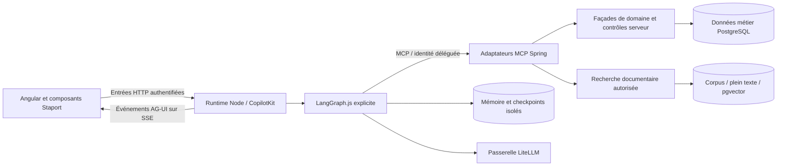

# ADR 0013 — Intégration IA : métier Java, orchestration TypeScript et RAG

- **Statut** : orientation demandée le 2026-10-23 ; conception détaillée proposée, à valider avant code.
- **Décideur** : propriétaire du projet.
- **Branche** : `codex/integration-ia-mcp-rag` ; aucune fusion ni publication de production dans ce lot.
- **Précédents** : [ADR 0008](0008-plateforme-ia-passerelle-agents-memoire-graphrag.md) et
  [ADR 0002](0002-interface-agentique-ag-ui-a2ui.md).

## Contexte vérifié

La proposition jointe vise Java 17/21, Spring Boot 3, Angular 18 et PrimeNG. Le dépôt utilise
Java 21, Spring Boot 4.1.1, Angular 22 et le kit Staport Aria/CDK/Tailwind. Les PDF utilisent
openhtmltopdf, pas JasperReports. Aucune migration de framework UI ou de moteur PDF n’est nécessaire.
Les versions exactes sont dans les manifests et lockfiles ; leur compatibilité IA n’est pas encore testée.

Le JWT REST actuel est auto-émis en HS256. Plusieurs contrôles de permission, de masquage du salaire
et d’audit sont attachés aux contrôleurs HTTP. Appeler directement leurs services depuis MCP ne
reproduit donc pas automatiquement leur politique de sécurité.

## Orientation explicitement demandée

1. Garder le monolithe modulaire Java/Spring propriétaire des données, transactions, règles,
   autorisations et audits. Ajouter des adaptateurs MCP vers ses façades publiques.
2. Placer l’orchestration de modèles dans un composant TypeScript/Node, avec des graphes
   LangGraph.js explicites. Ne pas introduire Spring AI, LangChain4j ou LangGraph4j dans ERP-RH.
3. Étudier CopilotKit Runtime et AG-UI pour Angular, puis une mémoire durable et le RAG.
4. Employer les protocoles selon un besoin identifié ; proposer aussi d’autres solutions utiles.

Cette orientation remplace la prescription Spring AI/MCP et l’orchestration Java de l’ADR 0008
pour ERP-RH. Les décisions de passerelle LiteLLM, classification, budgets, autorité métier et
isolation restent applicables. L’ADR 0002 reste la cible de présentation ; l’ordre d’introduction
d’A2UI/Rive est proposé séparément du pilote AG-UI et doit être validé.

## Choix à approuver

| ID | Options et conséquences | Recommandation proposée | Validation |
|---|---|---|---|
| D1 — pilote | Aide documentaire seule ; aide + référentiel Chantier en lecture ; analyse de paie plus sensible | Aide documentaire + une lecture Chantier, sans écriture ; utilisateur et corpus à confirmer | En attente |
| D2 — identité distribuée | Serveur OAuth/OIDC maintenu avec délégation ; émission/délégation locale dans Spring avec conformité OAuth à réaliser | Comparer sur un spike. Préférer un émetteur standard pris en charge si son coût d’exploitation est accepté ; ne pas développer de cryptographie ni partager `JWT_SECRET` | En attente |
| D3 — compatibilité MCP | Ligne stable commune SDK Java/client TypeScript ; nouvelle révision uniquement si stable et testée des deux côtés | Verrouiller une combinaison stable après tests ; SDK Java sans Spring AI candidat | En attente |
| D4 — interface | SDK Angular CopilotKit publié et compatible ; client AG-UI officiel intégré aux composants Staport | Tester d’abord le SDK Angular ; repli AG-UI si incompatibilité démontrée. Ne pas réintroduire PrimeNG | En attente du spike |
| D5 — persistance | Schémas dédiés sur instance PostgreSQL existante avec rôles séparés ; instance IA séparée | Commencer par isolation logique mesurée. Spring possède le corpus et l’index ; Node ne lit que sa mémoire/checkpoints | En attente |
| D6 — migrations checkpoints | Adaptation des migrations du saver à Flyway ; migration fournisseur administrée sur stockage séparé avec exception documentée | Favoriser Flyway sur la base gérée par le projet ; vérifier faisabilité/support des migrations du package avant choix. Aucun `setup()` automatique au runtime | En attente |
| D7 — modèles et budgets | Inférence locale ; fournisseur contractuel ; offres publiques limitées aux données publiques/synthétiques | Garder LiteLLM et classifier chaque flux, embeddings/reranker inclus ; choisir modèles, hébergement, plafonds, rétention avec le propriétaire | En attente |
| D8 — présentation avancée | Pilote texte + cartes typées ; A2UI et mascotte Rive dès le pilote | Livrer d’abord le flux utile ; introduire A2UI/Rive après validation accessibilité/poids et confirmation de ce séquencement | En attente |

Les recommandations sont comparables et révisables ; elles ne constituent pas une approbation du
propriétaire. Les détails d’implémentation sont dans le [plan](../ia/plan-integration.md).
L’accord initial P0.4 porte sur le périmètre et les expérimentations isolées. Les versions et
choix qui dépendent d’un spike sont validés après son résultat, avant adoption ; il n’est pas
nécessaire d’approuver une compatibilité encore inconnue pour autoriser son évaluation.

## Frontières proposées

Les API REST actuelles continuent de servir Angular. « Spring serveur MCP » décrit la nouvelle
frontière d’outils IA, pas la suppression du backend REST. Aucun client REST métier parallèle n’est
ajouté dans Node ; les échanges d’identité et le téléchargement d’artefacts sont des responsabilités
techniques distinctes. gRPC peut être proposé pour un autre besoin mesuré sans contourner MCP.

## Conséquences et portes

La séparation ajoute un processus, une frontière d’identité, un stockage durable et des coûts
d’exploitation. Elle exige des preuves avant généralisation : permissions sans fuite, audit des
outils, absence de double effet après crash, reprise sur un autre processus, citations vérifiées,
compatibilité Angular/transport, latence et coût mesurés. Aucun chiffre de production n’est disponible.

Une approbation est consignée ici avec date, choix D1–D8 et réserves exactes. Un accord sur le plan
ne vaut ni permission métier supplémentaire, ni autorisation de déploiement.
