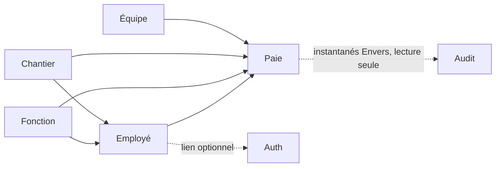

# Architecture de rh-erp

> Vue d'ensemble **concrète** du projet : ce qu'il contient, comment les domaines dépendent les uns des
> autres, et le trajet d'une requête de bout en bout. Les principes généraux (couches, patterns,
> conventions de code) sont dans `conventions/architecture.md` ; ce document décrit leur application ici.

---

## Vue d'ensemble

```text
Navigateur ── Angular (UI Staport) ──HTTP/JSON──▶ Spring Boot 4 (API REST) ──JPA──▶ PostgreSQL 18
                    │                                   │
                    │                                   ├── Flyway (schéma, migrations V1…V25, droits du compte applicatif)
                    │                                   ├── Hibernate Envers + journal d'audit (qui, quoi, quand, avant / après)
                    │                                   ├── Apache POI (imports/exports Excel)
                    │                                   ├── jsoup + openhtmltopdf + Batik (rapport PDF)
                    │                                   ├── JavaMail (mot de passe oublié)
                    │                                   └── Appel HTTP quotidien à l'ERP Staport (chantiers)
                    └── jeton d'accès en mémoire, jeton de rafraîchissement en cookie httpOnly
```

| Brique | Choix |
|---|---|
| Backend | Java 21 (JDK de build et d'exécution), Spring Boot 4.1.1, Spring Data JPA/Hibernate, Spring Security (resource server JWT), MapStruct, springdoc-openapi |
| Base | PostgreSQL 18.6 avec pgvector ; usage vectoriel uniquement lorsqu'un cas RAG sera validé |
| Migrations | Flyway ; Hibernate en `ddl-auto: validate` (il vérifie le schéma, ne le modifie jamais) |
| Frontend | Angular 22.2.2 standalone, Signals, Angular Aria/CDK, Tailwind CSS 4, Lucide et composants Staport |
| Tests | JUnit 5 + Mockito + AssertJ (backend), Vitest + Playwright/axe (frontend) — voir [testing.md](testing.md) |
| Livraison | Images Docker publiées par la CI ; nginx « inner » sert le frontend et relaie l'API — voir [deployment.md](deployment.md) |

**État des environnements au 2026-10-10 :** le Docker local est sur PostgreSQL 18.6 avec les données
migrées depuis PG17 ; le serveur de production reste sur PostgreSQL 17 jusqu'à l'exécution de la
procédure contrôlée décrite dans [deployment.md](deployment.md). Le Compose de la branche ne doit donc
pas encore être déployé tel quel en production.

---

## Les domaines

Un module backend par domaine métier (`backend/src/main/java/staport/rh/<domaine>/`) et un dossier
frontend du même nom (`frontend/src/app/portail/<domaine>/`).

| Domaine | Package backend | Table(s) | Dépend de (par façade de service) |
|---|---|---|---|
| Fonction | `function` | `fonction` | — |
| Chantier | `chantier` | `chantier` | — (source externe : ERP) |
| Équipe | `equipe` | `equipe` | — |
| Employé | `employee` | `employe` | Fonction, Chantier |
| Paie | `paie` | `paie` | Employé, Fonction, Chantier, Équipe, Audit (instantanés de restauration, lecture seule) |
| Auth | `auth` | `utilisateur`, `role`, `permission`, `role_permission`, `utilisateur_role`, `utilisateur_permission_refusee`, `refresh_token`, `reset_password_token` | Employé |
| Commun | `common` | — | Gestionnaire d'erreurs global, `ErrorResponseDto`, configuration OpenAPI et planification |



Une flèche signifie « utilise la façade de service de ». **Aucun domaine n'utilise le repository d'un
autre** (`conventions/architecture.md`, « Encapsulation des domaines ») : un domaine qui doit référencer
une entité d'un autre appelle `existsById` sur sa façade, puis attache l'entité par référence JPA
(`EntityManager.getReference`) sans la charger.

Pour restaurer un groupe supprimé, Paie demande à la façade `IAuditJournalService` les instantanés Envers d'une entrée de
suppression réussie. L'audit ne dépend pas du service Paie pour cette lecture et ne réalise aucune écriture métier ; la
restauration, ses invariants et son audit restent dans Paie.

Les composants transverses qui produisent des événements d'audit dépendent de `IAuditJournalWriter`, le port d'écriture
du domaine Audit. La consultation reste exposée par `IAuditJournalService`.

### Structure d'un module

```text
<domaine>/
├── controller/      Endpoints REST minces (aucune logique), @PreAuthorize sur chacun
├── dtos/            request/ (Create, Update, SearchCriteria) et response/
├── entities/        Entités JPA
├── exceptions/      Exceptions métier + gestionnaire d'erreurs du domaine
├── mappers/         MapStruct
├── repositories/    Spring Data JPA
├── services/        <Domaine>Service + interface I<Domaine>Service (la façade)
├── specifications/  Filtres de recherche dynamiques (JPA Specification)
├── imports/         (si applicable) import Excel
└── sync/ export/ report/   (si applicable) synchronisation ERP, export Excel, rapport PDF
```

---

## Trajet d'une requête

1. **Frontend** : l'intercepteur d'authentification ajoute `Authorization: Bearer <jeton d'accès>`. Sur un
   `401`, il tente un unique rafraîchissement (`/auth/refresh`, partagé entre les requêtes concurrentes) puis
   rejoue la requête ; en cas d'échec, il vide la session et renvoie vers `/login`.
2. **nginx inner** (en production) ou **proxy Angular** (en développement) : relaie vers le backend les
   chemins d'API. Les préfixes `/employees`, `/chantiers`, `/functions`, `/equipes`, `/paie` sont à la fois
   des routes Angular et des préfixes d'API : l'en-tête `Accept: text/html` (navigation) sert l'application,
   le reste va au backend.
3. **Spring Security** : valide la signature HS256 et l'expiration du jeton, transforme les claims
   `permissions` et `roles` en autorités.
4. **`@PreAuthorize("hasAuthority('X')")`** sur la méthode du contrôleur : refuse en `403` sans la permission.
5. **Validation** des DTO (`@Valid`) : `400` avec la liste `champ : message`.
6. **Service** : règles métier, vérification des doublons (`409`) et des références (`400`), transaction.
7. **Réponse** : DTO (jamais une entité). Toute erreur a la forme `ErrorResponseDto`
   (`timestamp`, `status`, `error`, `message`, `path`), affichée par l'intercepteur d'erreurs du frontend
   dans une notification.

### Codes d'erreur courants

| Code | Cause |
|---|---|
| 400 | Validation, référence inconnue (fonction, chantier, équipe, employé), import rejeté |
| 401 | Jeton absent, expiré, invalide ou signé avec un autre secret |
| 403 | Permission manquante (journalisé : événement `ACCES_REFUSE`) |
| 405 | Méthode HTTP non prévue pour la route |
| 404 | Ressource inexistante |
| 409 | Doublon (code, CIN, libellé, bulletin), suppression d'un élément encore référencé (dont un rôle attribué), groupe de bulletins modifié entre-temps |
| 500 | Erreur inattendue (message générique, détail dans les logs) |

---

## Traitements planifiés et externes

| Élément | Détail |
|---|---|
| Synchronisation des chantiers | Tous les jours à 23 h (`chantier.sync.cron`), ou à la demande (`POST /chantiers/sync`) — ajoute les chantiers absents, ne modifie rien. Voir [chantier/README.md](chantier/README.md) |
| Sauvegarde PostgreSQL | Service Docker dédié : exécution quotidienne à 02:00 UTC, rétention locale de 30 jours dans `./backups/` ; la destination locale seule est acceptée par décision du propriétaire. Restauration d'une archive réelle et alerte à organiser. Voir [deployment.md](deployment.md) |
| Bootstrap administrateur | Au démarrage, crée le compte `SYSTEM_ADMIN` s'il n'en existe aucun. Voir [auth/README.md](auth/README.md) |
| Vérification de l'intégrité de l'audit | Au démarrage, signale si le compte de la base peut modifier une table d'audit. Voir [audit/README.md](audit/README.md) |
| Courriel | Envoi du lien « mot de passe oublié » (SMTP) |

---

## Supervision et documentation d'API

| Élément | Accès |
|---|---|
| Swagger UI | `/swagger-ui.html` et spécification `/v3/api-docs`, **éteints par défaut** (donc en production) ; allumés en développement par `SPRINGDOC_API_DOCS_ENABLED` / `SPRINGDOC_SWAGGER_UI_ENABLED`, et publics alors. Éteints, leurs routes exigent un jeton comme le reste |
| Santé | `/actuator/health` (public — utilisé par les healthchecks Docker) ; l'état du serveur SMTP n'y est volontairement pas inclus |
| Autres endpoints Actuator | Non exposés (seuls `health` et `prometheus` le sont, `management.endpoints.web.exposure.include`) ; la règle de sécurité les réserve à `SYSTEM_ADMIN` s'ils sont un jour exposés |
| Métriques Prometheus | `/actuator/prometheus` (registre `micrometer-registry-prometheus`), public comme la santé (aucune donnée sensible) mais **joignable depuis le serveur seulement** : nginx inner ne relaie que `/actuator/health`, le port du backend est lié à `127.0.0.1`. Chaque série porte le tag `application` |
| Métriques applicatives | Compteurs et jauges d'audit, compteurs et histogramme de durée de synchronisation ; inventaire dans [chantier/README.md](chantier/README.md), implémentation dans `AuditMetrics` / `ChantierSyncMetrics`, garde-fous dans `MetricsConformityTest` ; raccordement opérationnel suivi dans `TODO.md` |
| Logs | SLF4J ; jamais de secret, identifiant de connexion, identité d'employé ni contenu métier/financier (voir `conventions/logging.md`). Format : texte en développement ; **JSON en production** (`LOGGING_FORMAT=json`) ; les événements sortent en temps réel sur la console et sont archivés chaque jour, compressés et gardés 30 jours UTC dans `./logs/`, à côté de `docker-compose.yml`. Seul `requestId` est ajouté au MDC et propagé aux tâches `@Async` ; l'acteur reste traçable dans l'audit à accès contrôlé |

---

## Frontend

Voir [frontend/README.md](frontend/README.md) : structure, routes, guards par permission, composants
partagés (sélecteur à chargement différé, tableaux configurables), conventions d'interface.

---

## Décisions d'architecture notables

| Décision | Raison |
|---|---|
| Schéma géré uniquement par Flyway (`validate`) | Aucune modification de schéma silencieuse ; les écarts entités/base font échouer le démarrage |
| Fonction, chantier et équipe copiés sur le bulletin (snapshot) | Un bulletin garde la situation du mois, même si l'employé est réaffecté ensuite |
| JWT auto-émis en HS256 | Un seul service émet et valide les jetons ; une paire de clés ne se justifie que si un autre service doit les valider |
| Jeton d'accès en mémoire, jeton de rafraîchissement en cookie `httpOnly` | Le jeton d'accès n'est jamais volable par du JavaScript injecté |
| Imports Excel atomiques et en ajout seul | Un fichier invalide ne laisse rien d'à moitié importé ; aucune modification silencieuse par fichier |
| Rapport PDF en HTML + openhtmltopdf, graphiques SVG | Pagination entièrement pilotée en Java (voir [report/README.md](report/README.md)) |
| CORS restreint par environnement | `CORS_ALLOWED_ORIGINS` fournit des origines explicites sans wildcard ni chemin (voir [deployment.md](deployment.md)) |
| Paie non calculée | Le total est repris tel que saisi ou importé (décision du 2026-10-03) |
| Audit : Envers + journal unique + événements de sécurité + garde-fous | Envers seul a des angles morts (écritures en masse, cascades SQL, migrations, événements sans donnée modifiée) ; chacun est fermé et prouvé par un test — voir [audit/README.md](audit/README.md) |
| Aspect d'audit à l'intérieur de la transaction (ordre explicite) | L'entrée d'une opération réussie est validée ou annulée avec ses données ; un échec est tracé à part |
| Deux comptes PostgreSQL | Sans séparation, l'application pourrait réécrire l'historique : un `REVOKE` serait cosmétique |

---

## Limites connues

### Intégration IA — cible décidée, non livrée

Le métier reste dans Spring ; un service IA Python (LangGraph) consomme des adaptateurs MCP Spring
et appelle les modèles par LiteLLM ; Angular dialogue avec lui par AG-UI. Les API REST et le kit
Staport restent les interfaces des écrans. Les jetons délégués par audience, les périmètres de
données par fiche de poste, la projection du salaire et l'audit de chaque outil sont des prérequis :
les protections des contrôleurs REST ne sont pas héritées par un appel direct aux services. Le RAG
ne recopie ni les employés ni la paie. Seule une preuve MCP existe, en profil de test isolé.
Décisions, feuille de route et état : [ia.md](ia.md).

### Autres limites

Voir [../TODO.md](../TODO.md) : domaine Pointage non construit, sauvegarde hors hôte et tests périodiques
de restauration à organiser, déploiement continu manuel, qualité des données (champs obligatoires et
doublons) à traiter en une tâche dédiée.
