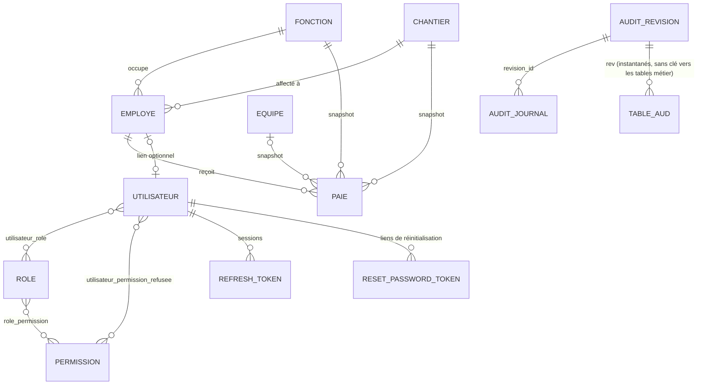

# Modèle de données

> Schéma PostgreSQL complet, tel que créé par les migrations Flyway (`backend/src/main/resources/db/migration`).
> Le détail colonne par colonne de chaque domaine métier est dans son README (`docs/<domaine>/README.md`) ;
> ce document donne la vue d'ensemble, les contraintes d'intégrité et l'historique des migrations.

---

## Schéma

Les clés primaires sont toutes des `BIGINT GENERATED ALWAYS AS IDENTITY`. Les noms de table sont au
singulier et en français, sauf `fonction` (la classe Java s'appelle `Function`), `employe` (classe
`Employee`) et `utilisateur` (jamais `user`, mot réservé PostgreSQL).

---

## Tables métier

| Table | Clé métier (unique) | Colonnes | Clés étrangères |
|---|---|---|---|
| `fonction` | `libelle` (unique après trim et comparaison sans casse, V27) | `libelle` (100, non nul), `version` | — |
| `chantier` | `code` (unique après trim et comparaison sans casse, V27) | `code` (100, non nul), `designation` (500), `nom` (255), `source_erp` (booléen, non nul, faux), `actif` (booléen, non nul, vrai), `version` | — |
| `equipe` | `code` et `libelle` (uniques après trim et mise en majuscules, V25 ; espaces extérieurs refusés en base par V27) | `code` (50), `libelle` (100), tous deux non nuls, `version` | — |
| `employe` | `cin` (unique après trim et comparaison sans casse, V27) | `nom_prenom` (150), `cin` (30), `date_naissance`, `date_embauche`, `statut` (`ACTIF`/`INACTIF`, contrôle `CHECK`), tous non nuls, `version` | `fonction_id`, `chantier_id` (non nuls) |
| `paie` | `(employee_id, periode)` | `periode` (entier `aaaaMM`), `nombre_jours_travailles`, `salaire_mensuel`, `salaire_total` (non nuls) ; `jours_recuperation_ouvrable`, `jours_recuperation_dimanche`, `prime_roulage_ordinaire`, `prime_roulage_dimanche`, `observation` (nullables), `version` | `employee_id`, `fonction_id`, `chantier_id` (non nuls), `equipe_id` (nullable) |

Détail et règles métier : [function](function/README.md), [chantier](chantier/README.md),
[equipe](equipe/README.md), [employee](employee/README.md), [paie](paie/README.md).

## Tables d'authentification

| Table | Rôle |
|---|---|
| `permission` | Catalogue **fixe** des permissions (une ligne par domaine × action), alimenté par migration, jamais modifié depuis l'interface. Code unique, `version` |
| `role` | Rôles administrables via l'interface. Nom unique après trim et comparaison sans casse (V27), `version` |
| `role_permission` | Association rôle ↔ permission (`ON DELETE RESTRICT` des deux côtés depuis `V13` : Hibernate retire d'abord les liaisons d'un rôle supprimé, ce que l'audit voit) |
| `utilisateur` | Compte de connexion : `username` et `email` uniques après trim et comparaison sans casse (V27), `mot_de_passe_hash` (BCrypt), `actif`, `employee_id` optionnel, `version`, compteurs et échéance de verrouillage temporaire après échecs de connexion |
| `utilisateur_role` | Association utilisateur ↔ rôle (`ON DELETE RESTRICT` depuis `V13`) |
| `utilisateur_permission_refusee` | Refus individuel : une ligne = permission retirée à cet utilisateur, quels que soient ses rôles (`ON DELETE RESTRICT` depuis `V13`) |
| `refresh_token` | Jeton de rafraîchissement **haché** (jamais en clair), `expire_le`, `revoque`, `famille`, `version` (identifiant de session, voir [auth/README.md](auth/README.md)) |
| `reset_password_token` | Lien « mot de passe oublié » **haché**, `expire_le`, `utilise`, `version` |
| `parametre` | Catalogue de valeurs de fonctionnement administrables, clé fixe et valeur unique, `version` ; détails dans [parametre/README.md](parametre/README.md) |

Toutes les entités persistées modifiables portent `version` (`@Version`, migration `V18`) ; le client la renvoie pour
une modification. Une version périmée est refusée avec `409 Conflict`. Les instantanés Envers et le journal append-only
restent immuables et ne portent pas de version.

Détail : [auth/README.md](auth/README.md).

---

## Tables d'audit

Écrites par Hibernate Envers et par l'aspect d'audit, jamais à la main (sauf par une migration qui suit le gabarit de
[`conventions/database.md`](../conventions/database.md)). Description fonctionnelle : [audit/README.md](audit/README.md).

| Table | Rôle |
|---|---|
| `audit_revision` | Une ligne par transaction qui modifie des données auditées : `horodatage` (`TIMESTAMPTZ`), `utilisateur_id` (**sans clé étrangère** : l'historique survit au compte), `utilisateur_nom` (figé), `origine` (`API`, `TACHE_PLANIFIEE`, `DEMARRAGE`, `MIGRATION`, `INCONNUE`), `request_id`, `adresse_ip` |
| `audit_revision_entite` | Types d'entités modifiés par chaque révision (clé `(revision_id, entite)`) |
| `<table>_aud` | Une par entité auditée — `fonction_aud`, `chantier_aud`, `equipe_aud`, `employe_aud`, `paie_aud`, `parametre_aud`, `permission_aud`, `role_aud`, `utilisateur_aud` — et une par liaison (`role_permission_aud`, `utilisateur_role_aud`, `utilisateur_permission_refusee_aud`). Colonnes : `id`, `rev` (→ `audit_revision`), `revtype` (`0` ajout, `1` modification, `2` suppression, avec tout le contenu de la ligne), puis les colonnes de l'entité, **toutes nullables** ; clé `(id, rev)` ; **aucune clé étrangère vers une table métier**. `utilisateur_aud` n'a pas de colonne de mot de passe |
| `audit_journal` | Le journal unique : `categorie` (`OPERATION`, `SECURITE`, `ACCES`), `action`, `type_operation`, `resultat` (`SUCCES`, `ECHEC`), identité et contexte, cible (`entite_type`, `entite_id`), `nombre_elements`, `perimetre` (`JSONB`), `motif`, `revision_id` (→ `audit_revision`), `hash_precedent` et `hash_entree` (chaîne SHA-256 locale). Index sur l'horodatage, l'utilisateur, la catégorie et l'action, la cible, l'identifiant de requête et la révision |

Le compte applicatif n'a que `SELECT` et `INSERT` sur ces tables (voir `afterMigrate.sql` ci-dessous et
[audit/README.md](audit/README.md), « Intégrité »).

---

## Intégrité et suppression

### Unicité (aucun doublon)

| Donnée | Garantie en base | Garantie en service |
|---|---|---|
| Fonction (`libelle`) | `V27` : index unique sur `UPPER(BTRIM(libelle))` et contrainte anti-espaces extérieurs | Valeur trimée, comparaison insensible à la casse, `409` |
| Chantier (`code`) | `V27` : index unique sur `UPPER(BTRIM(code))` et contrainte anti-espaces extérieurs | Valeur trimée, comparaison insensible à la casse, `409` |
| Équipe (`code`, `libelle`) | `V25` : index uniques sur `UPPER(BTRIM(...))` | Code et libellé trimés, comparaison insensible à la casse, `409` |
| Employé (`cin`) | `V27` : index unique sur `UPPER(BTRIM(cin))` et contrainte anti-espaces extérieurs | Valeur trimée, comparaison insensible à la casse, `409` |
| Bulletin (employé, période) | `UNIQUE` | Contrôle avant création, `409` |
| Utilisateur (`username`, `email`) | `V27` : index uniques sur `UPPER(BTRIM(...))` et contraintes anti-espaces extérieurs | Valeur trimée, comparaison insensible à la casse, `409` |
| Rôle (`nom`) | `V27` : index unique sur `UPPER(BTRIM(nom))` et contrainte anti-espaces extérieurs | Valeur trimée, comparaison insensible à la casse, `409` |

Limites actuelles : les index fonctionnels bloquent l'égalité après normalisation, mais pas les
quasi-doublons sémantiques (`TECHNICIEN DE QUALITE` / `THECNICIEN DE QUALITE`). Ces cas et les
doublons préexistants éventuels sont instruits dans la
tâche « Qualité des données » ([../TODO.md](../TODO.md)).

### Que se passe-t-il à la suppression ?

| Élément supprimé | Comportement |
|---|---|
| Fonction référencée par un employé ou un bulletin | Bloqué : `409` |
| Chantier référencé par un employé ou un bulletin | Bloqué : `409` |
| Équipe référencée par un bulletin | Bloqué : `409` |
| Employé **sans** bulletin ni compte lié | Supprimé |
| Employé **avec** des bulletins ou un compte utilisateur lié | **Erreur `500`** : aucune règle n'a été définie pour ce cas (voir [../TODO.md](../TODO.md)) |
| Bulletin | Supprimé (aucune contrainte) |
| Rôle **attribué** à au moins un compte | Bloqué : `409` (retirez-le d'abord des comptes) |
| Rôle `SYSTEM_ADMIN` | Bloqué : `409`, jamais supprimable |
| Rôle non attribué | Supprimé, avec ses associations rôle ↔ permission (retirées une à une, donc auditées) |
| Utilisateur | Pas d'endpoint de suppression : un compte se désactive (`actif = false`) |

### Snapshot du bulletin

`paie.fonction_id`, `paie.chantier_id` et `paie.equipe_id` figent la situation du **mois du bulletin**. Ils
ne suivent jamais les changements d'affectation de l'employé. Voir [paie/README.md](paie/README.md).

### Valeurs monétaires et périodes

- Montants en `NUMERIC(10,2)`, jours travaillés et jours de récupération en `NUMERIC(5,2)`.
- La période est un `YearMonth` Java stocké en entier `aaaaMM` (ex. `202609`) par
  `YearMonthAttributeConverter` ; l'API l'expose au format `aaaa-MM`.
- Aucun calcul de paie en base ni côté serveur : `salaire_total` est stocké tel que saisi ou importé.

---

## Historique des migrations

Les migrations appliquées ne sont **jamais modifiées** : toute évolution du schéma est une nouvelle migration.
Un commentaire d'une ancienne migration peut donc décrire un comportement qui a changé depuis (ex. V5 parle
d'une désignation « écrasée à chaque synchronisation », ce qui n'est plus vrai).

| Version | Contenu |
|---|---|
| `V1` | Extension `vector` (pgvector), activée par anticipation |
| `V2` | Schéma initial : `fonction`, `chantier`, `employe`, `paie` |
| `V3` | Authentification : `permission`, `role`, `role_permission`, `utilisateur`, `utilisateur_role`, `utilisateur_permission_refusee`, `refresh_token`, `reset_password_token` |
| `V4` | Catalogue de 19 permissions et rôles `SYSTEM_ADMIN` (tout) et `PAIE_MANAGER` (tout sauf gestion des comptes et des rôles) |
| `V5` | `chantier.nom` (nom d'usage, saisi à la main) |
| `V6` | Renseigne `chantier.nom` pour les chantiers connus (liste de la direction du 2026-09-29) |
| `V7` | Table `equipe` et 17 équipes de départ |
| `V8` | `paie.equipe` (texte libre) remplacé par `paie.equipe_id` (clé étrangère), avec reprise des données et garde-fou : la migration échoue plutôt que de perdre une valeur |
| `V9` | Permissions `EQUIPE_READ/WRITE/DELETE`, attribuées aux rôles qui portent déjà celles du chantier |
| `V10` | `refresh_token.famille` (révocation de toute la session en cas de réutilisation d'un jeton) |
| `V11` | Audit : `audit_revision`, `audit_revision_entite`, une table `_aud` par entité auditée et par liaison, `audit_journal` |
| `V12` | Permission `AUDIT_READ`, attribuée à `SYSTEM_ADMIN` seulement |
| `V13` | Liaisons rôle / permission / compte en `ON DELETE RESTRICT` (plus de retrait silencieux de droits par cascade SQL) |
| `V14` | **État initial de l'audit** : une révision (origine `MIGRATION`) qui enregistre toutes les lignes existantes, et son entrée `AUDIT_ETAT_INITIAL` |
| `V15` | Permission `PAIE_PURGE` (suppression en groupe), attribuée à `SYSTEM_ADMIN` et aux rôles qui ont `PAIE_DELETE` ; écrit sa révision d'audit (premier usage du gabarit de migration auditée) |
| `V16` | Paramètres de fonctionnement administrables et permissions `PARAMETRE_READ/WRITE` attribuées à `SYSTEM_ADMIN` |
| `V17` | Permission `PAIE_RESTORE`, attribuée à `SYSTEM_ADMIN` seul à l'installation et administrable ensuite depuis l'écran Rôles |
| `V18` | Verrou optimiste `@Version` sur les entités persistées modifiables |
| `V19` | Chaînage SHA-256 du journal d'audit |
| `V20` | Activation conditionnelle de pgAudit pour la base ERP-RH en production |
| `V21` | Compteur de tentatives et blocage temporaire après cinq échecs de connexion |
| `V22` | Unicité du CIN sans tenir compte de la casse |
| `V23` | Unicité du libellé de fonction sans tenir compte de la casse |
| `V24` | Unicité du code de chantier sans tenir compte de la casse |
| `V25` | Unicité du code et du libellé d'équipe après trim et sans tenir compte de la casse |
| `afterMigrate.sql` | Rappel Flyway, rejoué après **chaque** migration : crée le compte applicatif s'il n'existe pas et recalcule ses droits (`SELECT, INSERT` seulement sur les tables d'audit). Sans effet quand le compte applicatif est le propriétaire |

### Règles d'écriture d'une migration

- Nommage `V<n>__description_en_minuscules.sql`, numérotation continue.
- Une migration qui transforme des données doit vérifier qu'elle ne perd rien et échouer sinon (voir `V8`).
- Les permissions se créent par migration (catalogue fixe) ; l'attribution aux rôles existants est faite dans
  la même migration.
- **Depuis `V14`, une migration qui modifie des données d'une table auditée écrit aussi sa révision, ses lignes d'audit et son
  entrée de journal** (gabarit de `conventions/database.md`, exemple dans [audit/README.md](audit/README.md)). Une
  entité auditée ou une colonne ajoutée à une entité auditée s'accompagne de sa table / colonne `_aud` dans la même migration.
- Les tests (`PaieApplicationTests` et les tests d'intégration de l'audit) démarrent l'application sur une base vide :
  toute la chaîne V1 → V25 est rejouée et validée contre les entités à chaque exécution.

Voir aussi `conventions/database.md`.
