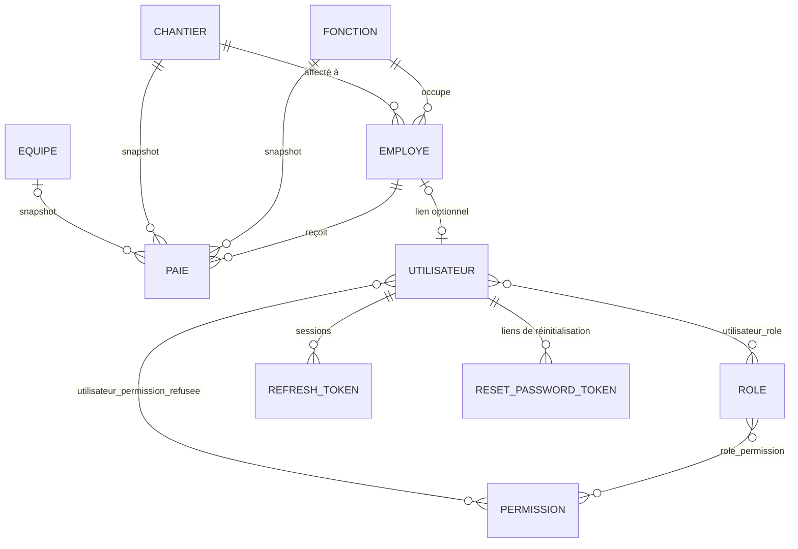

# Modèle de données

> Schéma PostgreSQL complet, tel que créé par les migrations Flyway (`backend/src/main/resources/db/migration`).
> Le détail colonne par colonne de chaque domaine métier est dans son README (`docs/<domaine>/README.md`) ;
> ce document donne la vue d'ensemble, les contraintes d'intégrité et l'historique des migrations.

---

## Schéma

Les clés primaires sont toutes des `BIGINT GENERATED ALWAYS AS IDENTITY`. Les noms de table sont au
singulier et en français, sauf `fonction` (la classe Java s'appelle `Function`), `employe` (classe
`Employee`) et `utilisateur` (jamais `user`, mot réservé PostgreSQL).

---

## Tables métier

| Table | Clé métier (unique) | Colonnes | Clés étrangères |
|---|---|---|---|
| `fonction` | `libelle` | `libelle` (100, non nul) | — |
| `chantier` | `code` | `code` (100, non nul), `designation` (500), `nom` (255), `source_erp` (booléen, non nul, faux), `actif` (booléen, non nul, vrai) | — |
| `equipe` | `code` **et** `libelle`, plus un index unique sur `UPPER(code)` | `code` (50), `libelle` (100), tous deux non nuls | — |
| `employe` | `cin` | `nom_prenom` (150), `cin` (30), `date_naissance`, `date_embauche`, `statut` (`ACTIF`/`INACTIF`, contrôle `CHECK`), tous non nuls | `fonction_id`, `chantier_id` (non nuls) |
| `paie` | `(employee_id, periode)` | `periode` (entier `aaaaMM`), `nombre_jours_travailles`, `salaire_mensuel`, `salaire_total` (non nuls) ; `jours_recuperation_ouvrable`, `jours_recuperation_dimanche`, `prime_roulage_ordinaire`, `prime_roulage_dimanche`, `observation` (nullables) | `employee_id`, `fonction_id`, `chantier_id` (non nuls), `equipe_id` (nullable) |

Détail et règles métier : [function](function/README.md), [chantier](chantier/README.md),
[equipe](equipe/README.md), [employee](employee/README.md), [paie](paie/README.md).

## Tables d'authentification

| Table | Rôle |
|---|---|
| `permission` | Catalogue **fixe** des permissions (une ligne par domaine × action), alimenté par migration, jamais modifié depuis l'interface. Code unique |
| `role` | Rôles administrables via l'interface. Nom unique |
| `role_permission` | Association rôle ↔ permission (suppression en cascade des deux côtés) |
| `utilisateur` | Compte de connexion : `username` et `email` uniques, `mot_de_passe_hash` (BCrypt), `actif`, `employee_id` optionnel |
| `utilisateur_role` | Association utilisateur ↔ rôle (cascade) |
| `utilisateur_permission_refusee` | Refus individuel : une ligne = permission retirée à cet utilisateur, quels que soient ses rôles |
| `refresh_token` | Jeton de rafraîchissement **haché** (jamais en clair), `expire_le`, `revoque`, `famille` (identifiant de session, voir [auth/README.md](auth/README.md)) |
| `reset_password_token` | Lien « mot de passe oublié » **haché**, `expire_le`, `utilise` |

Détail : [auth/README.md](auth/README.md).

---

## Intégrité et suppression

### Unicité (aucun doublon)

| Donnée | Garantie en base | Garantie en service |
|---|---|---|
| Fonction (`libelle`) | `UNIQUE` | Comparaison insensible à la casse, `409` |
| Chantier (`code`) | `UNIQUE` | Comparaison insensible à la casse, `409` |
| Équipe (`code`, `libelle`) | `UNIQUE` + index sur `UPPER(code)` | Code normalisé (espaces retirés, majuscules), comparaison insensible à la casse, `409` |
| Employé (`cin`) | `UNIQUE` | Comparaison insensible à la casse, `409` |
| Bulletin (employé, période) | `UNIQUE` | Contrôle avant création, `409` |
| Utilisateur (`username`, `email`) | `UNIQUE` | Contrôle avant création/modification, `409` |
| Rôle (`nom`) | `UNIQUE` | Contrôle avant création/modification, `409` |

Limites actuelles : seule l'égalité exacte (hors casse) est bloquée, pas les quasi-doublons
(`TECHNICIEN DE QUALITE` / `THECNICIEN DE QUALITE`) ; la base n'impose pas l'insensibilité à la casse
partout (seule l'équipe a un index sur `UPPER(code)`). Traité dans la tâche « Qualité des données »
([../TODO.md](../TODO.md)).

### Que se passe-t-il à la suppression ?

| Élément supprimé | Comportement |
|---|---|
| Fonction référencée par un employé ou un bulletin | Bloqué : `409` |
| Chantier référencé par un employé ou un bulletin | Bloqué : `409` |
| Équipe référencée par un bulletin | Bloqué : `409` |
| Employé **sans** bulletin ni compte lié | Supprimé |
| Employé **avec** des bulletins ou un compte utilisateur lié | **Erreur `500`** : aucune règle n'a été définie pour ce cas (voir [../TODO.md](../TODO.md)) |
| Bulletin | Supprimé (aucune contrainte) |
| Rôle | Supprimé, avec ses associations rôle ↔ permission et utilisateur ↔ rôle (les utilisateurs perdent ce rôle à leur prochain rafraîchissement) |
| Utilisateur | Pas d'endpoint de suppression : un compte se désactive (`actif = false`) |

### Snapshot du bulletin

`paie.fonction_id`, `paie.chantier_id` et `paie.equipe_id` figent la situation du **mois du bulletin**. Ils
ne suivent jamais les changements d'affectation de l'employé. Voir [paie/README.md](paie/README.md).

### Valeurs monétaires et périodes

- Montants en `NUMERIC(10,2)`, jours de récupération en `NUMERIC(5,2)`.
- La période est un `YearMonth` Java stocké en entier `aaaaMM` (ex. `202609`) par
  `YearMonthAttributeConverter` ; l'API l'expose au format `aaaa-MM`.
- Aucun calcul de paie en base ni côté serveur : `salaire_total` est stocké tel que saisi ou importé.

---

## Historique des migrations

Les migrations appliquées ne sont **jamais modifiées** : toute évolution du schéma est une nouvelle migration.
Un commentaire d'une ancienne migration peut donc décrire un comportement qui a changé depuis (ex. V5 parle
d'une désignation « écrasée à chaque synchronisation », ce qui n'est plus vrai).

| Version | Contenu |
|---|---|
| `V1` | Extension `vector` (pgvector), activée par anticipation |
| `V2` | Schéma initial : `fonction`, `chantier`, `employe`, `paie` |
| `V3` | Authentification : `permission`, `role`, `role_permission`, `utilisateur`, `utilisateur_role`, `utilisateur_permission_refusee`, `refresh_token`, `reset_password_token` |
| `V4` | Catalogue de 19 permissions et rôles `SYSTEM_ADMIN` (tout) et `PAIE_MANAGER` (tout sauf gestion des comptes et des rôles) |
| `V5` | `chantier.nom` (nom d'usage, saisi à la main) |
| `V6` | Renseigne `chantier.nom` pour les chantiers connus (liste de la direction du 2026-09-29) |
| `V7` | Table `equipe` et 17 équipes de départ |
| `V8` | `paie.equipe` (texte libre) remplacé par `paie.equipe_id` (clé étrangère), avec reprise des données et garde-fou : la migration échoue plutôt que de perdre une valeur |
| `V9` | Permissions `EQUIPE_READ/WRITE/DELETE`, attribuées aux rôles qui portent déjà celles du chantier |
| `V10` | `refresh_token.famille` (révocation de toute la session en cas de réutilisation d'un jeton) |

### Règles d'écriture d'une migration

- Nommage `V<n>__description_en_minuscules.sql`, numérotation continue.
- Une migration qui transforme des données doit vérifier qu'elle ne perd rien et échouer sinon (voir `V8`).
- Les permissions se créent par migration (catalogue fixe) ; l'attribution aux rôles existants est faite dans
  la même migration.
- Les tests (`PaieApplicationTests`) démarrent l'application sur une base vide : toute la chaîne V1 → V10 est
  rejouée et validée contre les entités à chaque exécution.

Voir aussi `conventions/database.md`.
