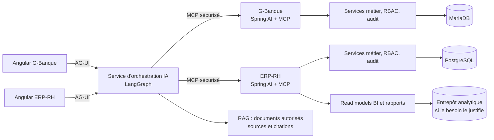

# Proposition — Socle Staport pour les applications, BI et IA

**État :** décisions de direction validées ; socle `staport-standards` v0.1.1 créé et épinglé dans ERP-RH ; G-Banque reste à synchroniser  
**Date de référence :** 2026-10-10  
**Périmètre :** G-Banque, ERP-RH et futurs projets Staport

## But

Définir un socle réutilisable de conventions et de pratiques d'agents, tout en gardant dans chaque
projet les règles qui dépendent réellement de son métier, de sa base, de son modèle d'accès et de
son déploiement. Préparer une architecture où chaque application garde ses règles métier, expose
des capacités encadrées aux agents, et peut participer à une BI commune.

Cette proposition part de l'existant : G-Banque est en Spring Boot 3.5.16, Angular 17 et MariaDB ;
ERP-RH est en Spring Boot 4.1.1, Angular 17 et PostgreSQL/Flyway. ERP-RH a déjà une vue analytique
de paie et un rapport PDF de synthèse. La cible commune est maintenant PostgreSQL/Flyway, RBAC par
domaine et audit ERP-RH ; la migration de données G-Banque reste une opération dédiée et contrôlée.

## État des lieux des écarts qui doivent rester explicites

| Sujet | G-Banque | ERP-RH | Traitement proposé |
|---|---|---|---|
| Base et migrations | MariaDB, `ddl-auto=update` dans l'état/convention observé | PostgreSQL, Flyway SQL versionné, `ddl-auto=validate` | Cible : PostgreSQL + Flyway sur les deux applications, bases distinctes ; G-Banque migre les données selon un plan dédié. |
| Autorisations | `SYSTEM_ADMIN` et règles codées dans l'application | RBAC dynamique par permission, rôles administrables et refus individuels | Cible commune : RBAC dynamique par domaine selon ERP-RH ; catalogue par application et contrôles serveur. |
| Audit | `Log`, journal après commit selon la convention observée | Envers + `audit_journal`, succès atomique à la transaction et échec écrit à part | Cible commune : trois couches ERP-RH (Envers, journal unique, garde-fous PostgreSQL), avec catalogue d'actions propre à chaque application. |
| Frontend | Angular 17, PrimeNG 17, PrimeFlex, PrimeIcons | Angular 17, PrimeNG 17, PrimeIcons, Tailwind/SCSS partiel et design system avancé | Cible Angular 22 stable avec Signals et Signal Forms ; Tailwind 4, Lucide, Angular Aria/CDK, design system Staport. Migration progressive. |
| Domaine | Comptes, trésorerie, financements, rapprochements | Employés, chantiers, équipes et paie | Une documentation de domaine par application ; aucune règle métier financière ou RH dans le socle commun. |

### Incohérence documentaire G-Banque à corriger

Le `CLAUDE.md` G-Banque impose un unique `docs/rbac/README.md`, avec un chapitre par module ; sa
convention `conventions/security.md` demande au contraire un fichier par module
(`docs/rbac/<module>.md`). La règle la plus précise du `CLAUDE.md` sera la référence : corriger
`conventions/security.md` pour pointer vers le README unique et y documenter les chapitres par
module. Le modèle d'autorisation de G-Banque lui-même ne change pas dans cette correction.

## Socle documentaire proposé

### Répartition

1. **Socle commun** — règles réutilisables : architecture modulaire, qualité et style de code,
   configuration, API, sécurité de base, audit de base, logs/observabilité, performance,
   accessibilité, UX, documentation, stratégie de tests de l'unitaire à l'end-to-end, CI/CD,
   IA/agents, MCP, RAG et BI.
2. **Profils techniques** — règles dépendant d'une technologie : Java/Spring, Angular, PostgreSQL +
   Flyway, MariaDB, fournisseur d'identité, environnement de déploiement, stockage vectoriel.
3. **Profil du projet** — conventions métiers, architecture réelle, permissions, tables et règles
   de données, modules, déploiement et décisions acceptées.

Les conflits entre profils doivent être nommés ; les profils ne s'appliquent qu'aux dépôts qui les
déclarent. Un guide commun ne doit pas prétendre qu'un projet utilise Flyway, un RBAC dynamique ou
un modèle d'audit transactionnel qui n'existe pas dans ce projet.

### Source commune et outils de développement assistés

Options pour partager le socle :

| Option | Avantage | Coût / risque |
|---|---|---|
| Copier les conventions communes dans chaque dépôt | Immédiat, aucun outil supplémentaire | Dérive silencieuse ; doublons difficiles à corriger |
| Dépôt de standards/template versionné, puis synchronisation des fichiers communs dans chaque application | Source de vérité et historique central ; les projets gardent des conventions visibles et versionnées localement | Nécessite une routine de mise à jour et une vérification de dérive |
| Sous-module Git partagé directement dans chaque application | Pas de copie de fichiers communs | Rend les clones, outils IA et pipelines dépendants de l'initialisation du sous-module ; les changements transverses sont moins naturels à relire |

**Recommandation :** créer un dépôt de template/standards Staport versionné ; chaque application
embarque une copie synchronisée des fichiers communs, un profil local et un identifiant de version
du template. Une vérification légère détecte les écarts inattendus. Les nouveaux projets partent
du template. Cette approche laisse chaque dépôt autonome pour construire, relire et donner son
contexte aux agents.

Le template contient aussi les instructions et compétences d'agents. Les instructions racine
(`AGENTS.md`, `CLAUDE.md`) restent courtes et désignent la source documentaire active. Les skills
sont ciblées et explicables, par exemple : migrations de base propres au profil, revue sécurité,
front Angular/design system, audit MCP, modélisation BI et évaluation RAG. Les agents spécialisés
peuvent être backend, frontend/design, données/BI, IA/RAG et sécurité. Ils n'accordent aucun droit
à l'application : **une skill ou un agent n'est jamais un mécanisme d'autorisation**.

## Qualité et stratégie de tests — de l'unitaire à l'end-to-end

Chaque changement doit être vérifié au niveau où son risque se manifeste. La suite forme une
pyramide : beaucoup de tests unitaires rapides, des tests de composants et d'intégration ciblés,
puis un nombre réduit de parcours end-to-end représentatifs. Les tests ne remplacent ni la revue
de sécurité ni l'observabilité en production.

| Niveau | Ce qu'il prouve | Exemples Staport |
|---|---|---|
| Statique et architecture | Cohérence des types, format, dépendances permises et règles d'architecture | Compilation, lint, format, détection de dépendances interdites, vérification OpenAPI générée |
| Unitaire | Une règle isolée fonctionne dans ses cas normaux et limites | Services métier Spring, calcul de paie/commissions, validateurs, permissions, composants Angular, reducers/signals et formatage |
| Composant/UI | Le composant rend ses états, clavier et interactions accessibles | Formulaires, tableaux, filtres, commandes, panneau agent, états chargement/vide/erreur et `prefers-reduced-motion` |
| Intégration | Les composants réels collaborent correctement | Repositories avec la base de test correspondant au profil, migrations Flyway, sécurité/RBAC, audit transactionnel, contrôleurs, adaptateurs MCP, stockage RAG et projections BI |
| Contrat | Deux services ou une UI et une API respectent le même contrat | OpenAPI, schémas d'outils MCP, événements AG-UI, compatibilité des événements streaming et schémas d'échange BI |
| End-to-end (E2E) | Un parcours utilisateur complet fonctionne dans l'application assemblée | Connexion et permissions, parcours métier critique, filtres et pagination, affichage d'un insight sourcé, demande d'approbation puis résultat d'un outil |
| Non-fonctionnel | Le service reste sûr, fiable et réactif sous conditions définies | Tests d'autorisation négatifs, injection d'instructions, charge/latence, timeout/retry/idempotence, accessibilité automatisée et contrôle de taille/coût IA |

Règles d'exécution proposées :

- Exécuter format, lint, compilation et tests unitaires sur chaque changement pertinent ; les tests
  de contrat et d'intégration s'exécutent au minimum sur les changements backend/API concernés et
  avant fusion. Les parcours E2E couvrent les fonctions à risque et tournent sur une application
  assemblée dans un environnement reproductible.
- Utiliser la vraie technologie de persistance ciblée dans les tests d'intégration de base de
  données : MariaDB pour G-Banque et PostgreSQL pour ERP-RH. Tester l'application des migrations
  depuis un schéma vierge et une mise à niveau depuis une version supportée.
- Préparer des données de test synthétiques, réinitialisables et sans données personnelles réelles.
  Les tests vérifient explicitement les refus d'accès, l'isolation des rôles/tenants si applicable,
  l'audit et l'absence de secrets ou données sensibles dans les logs.
- Stabiliser les E2E avec des sélecteurs accessibles (`role`, nom accessible, libellé) et des
  assertions sur le résultat observable ; éviter les temporisations arbitraires et les tests
  dépendant de détails CSS. Capturer traces et captures d'écran en échec sans y inclure de secrets.
- Pour MCP et l'IA, tester les schémas, autorisations, limites, refus, timeouts, retries et injections
  adversariales. Évaluer les réponses sur des jeux de cas versionnés avec critères de justesse,
  sources/citations, sécurité, latence et coût ; les évaluations probabilistes complètent les tests
  déterministes et ne les remplacent pas.
- Pour BI, tester les formules des indicateurs sur des exemples de référence, les filtres et
  permissions, les fuseaux/périodes, les arrondis et l'absence de double comptage. Comparer les
  projections aux données de référence sur des fixtures connues.
- Distinguer les contrôles rapides des contrôles complets avant fusion et release. Une dérogation
  temporaire à un contrôle obligatoire doit être motivée, attribuée et datée.

Les versions exactes des runners et outils de test seront fixées dans les profils de technologie
après inventaire du code. Le socle impose les niveaux, les preuves attendues et les portes CI ; il
ne force pas un runner unique si Angular, Spring ou le navigateur nécessitent des outils distincts.

## Versions et stratégie de mise à niveau

Vérification effectuée le 10 octobre 2026 auprès des sources officielles :

| Composant | État des projets | Cible recommandée |
|---|---|---|
| Spring Boot | ERP-RH : 4.1.1 ; G-Banque : 3.5.16 | Aligner G-Banque sur Spring Boot 4.1.1 après analyse des dépendances ; ERP-RH y est déjà. Vérifier JDK et intégrations de chaque projet. |
| Angular | Les deux projets : 17.3 | Angular 22.1.6 est la dernière version stable vérifiée ; v22 est activement supportée. Migrer une majeure à la fois et aligner CLI, TypeScript, RxJS et bibliothèques peer. Signal Forms et Angular Aria sont stables depuis v22.0. |
| PrimeNG | Les deux projets : 17 | Ne pas porter PrimeNG 17 directement vers le dernier Angular. Vérifier compatibilité, guide de migration et licence exacte de la version cible avant choix. Garder la librairie de composants derrière les wrappers du design system pendant la transition. |

Le numéro de version est une photographie datée, pas une valeur permanente de convention. Le socle
doit imposer une vérification des versions stables et prises en charge avant chaque nouveau projet
ou mise à niveau. Les versions `next`, `rc`, `alpha`, `beta` et les snapshots sont exclues d'une
cible de production, sauf décision explicite.

Une mise à niveau majeure doit être une tâche dédiée, avec une étape par version majeure, migration
des bibliothèques tierces, compilation et vérification des parcours clés à chaque étape. La
migration G-Banque Spring Boot 4 est plus risquée qu'une mise à jour de correctif : Spring Boot 4
introduit une modularisation et des changements d'API, et demande de contrôler toutes les
dépendances tierces.

## Direction UI/UX et design system Staport

### Ce que l'on conserve et améliore

Le design system ERP-RH fournit une bonne base : primitives → sémantiques → composants, thème clair
et sombre, bleu marine du logo (`#084478`, référencé comme `--brand-700`), typographie embarquée,
jetons de mouvement, tableaux denses, palettes de graphiques et respect de `prefers-reduced-motion`.
Il faut étendre cette base, pas effacer ses acquis.

**Direction proposée : “Staport Intelligent Operations”** — une interface métier premium et
immersive, inspirée du bleu profond du logo et de l'univers construction/finance, avec des surfaces
précises, des données très lisibles et une accentuation lumineuse réservée aux actions et aux
insights. La personnalité vient de la composition, des typographies, des graphiques, des états et
du mouvement cohérent ; pas d'un écran rempli de halos, dégradés et panneaux de verre.

Règles proposées :

- Conserver le bleu du logo comme ancrage de marque ; construire la palette secondaire à partir
  d'échantillons réels du logo et de tests de contraste, sans inventer des couleurs de statut.
- Définir des tokens primitifs, sémantiques et de composants, avec thèmes clair/sombre et variantes
  de contraste. Les composants ne portent pas de couleurs arbitraires.
- Remplacer **PrimeFlex** par **Tailwind CSS 4** pour les utilitaires de mise en page, derrière des
  composants/classes sémantiques du projet ; Tailwind n'est pas une raison de mettre de longues
  chaînes de classes dupliquées dans chaque écran.
- Remplacer **PrimeIcons** par **Lucide pour Angular**, en n'incluant que les icônes utilisées.
- Utiliser **Angular CDK** et les primitives d'accessibilité Angular pour les comportements
  (focus, clavier, superpositions, drag/drop, virtual scroll), sans imposer l'apparence Material.
- Garder PrimeNG existant temporairement pour éviter une réécriture simultanée ; ne pas en faire la
  dépendance du nouveau design system. Évaluer sa version cible et sa licence avant de décider de
  le conserver ou de le remplacer progressivement. Ne pas mélanger plusieurs librairies complètes
  de composants dans le même écran.
- Construire un petit ensemble de composants Staport : navigation, boutons, formulaires,
  sélecteurs, tableaux, cartes KPI, graphiques, notifications, panneau IA et états de chargement.
  Les composants partagés portent les règles d'accessibilité, responsive, focus et états.
- Pour les graphiques, choisir une mesure et une question par visualisation ; fournir une version
  tabulaire/accessibilité, une légende compréhensible, des formats locaux, une palette distinguable
  et le même sens de couleur d'une page à l'autre.
- Les animations signalent une transition, un résultat ou une action. Elles restent courtes,
  pilotées par des tokens, ne bloquent jamais la saisie et respectent `prefers-reduced-motion`.
  Les animations complexes éventuelles passent par un seul outil dédié, introduit seulement si un
  besoin concret le justifie.
- Chaque écran dispose d'états chargement, vide, erreur, succès, hors-ligne et permission refusée.
  Les écrans de données restent efficaces à clavier, lecteurs d'écran, téléphone et écran large.

Tailwind CSS 4 est documenté officiellement pour Angular. Angular CDK est le socle d'infrastructure
de composants maintenu avec Angular ; Lucide fournit un paquet Angular et un arbre d'icônes
réductible au bundle.

### AG-UI : protocole de l'interface agentique

AG-UI est la couche d'échange agent ↔ interface ; ce n'est pas une librairie visuelle ni une
substitution à Angular. L'interface Angular consomme des événements structurés et les rend dans le
design system Staport : streaming, changements d'état, progression, appels d'outils, interruptions,
approbations humaines et données structurées. Les sorties génératives sont limitées à des cartes et
composants connus de l'application ; l'agent ne fournit pas de HTML ou de code arbitraire à exécuter.

## Architecture BI et IA proposée

### IA : une responsabilité à chaque niveau

- **Dans chaque application : Spring AI** pour les usages IA locaux au domaine, avec modèles,
  prompts, retrieval et appels métier définis par ce domaine. Chaque backend expose, au besoin, un
  serveur MCP limité à des opérations métier déjà validées par ses services.
- **Service central Python : LangGraph** orchestre des parcours traversant G-Banque et ERP-RH,
  consomme leurs outils MCP et expose une interface AG-UI. Il n'accède jamais directement à leurs
  bases.
- **LangChain** fournit les composants/integrations utiles dans ce service. **Deep Agents** est une
  option de harness pour les tâches longues qui nécessitent plan, délégation, gestion de contexte,
  compétences et checkpoints humains ; il s'appuie sur les briques LangChain/LangGraph. Ne pas
  installer les trois comme trois runtimes concurrents : commencer avec LangGraph, ajouter Deep
  Agents seulement pour un cas d'usage qui en profite.
- **Skills** : procédures chargées à la demande par un agent, versionnées et relues comme du code.
  Une skill peut guider la recherche et le format de réponse ; elle ne donne ni accès ni permission.
- **RAG** : indexer uniquement des corpus autorisés, avec métadonnées d'accès et fraîcheur ; rendre
  les sources citées. Les documents récupérés sont des données non fiables, jamais des consignes
  système. Les dossiers RH/paie et les données financières exigent minimisation, filtrage et
  contrôle d'accès avant toute ingestion ou envoi à un fournisseur.

### Garde-fous MCP et agents

- Le serveur MCP n'expose que des outils métier nommés, typés, documentés et bornés. Chaque outil
  appelle le même service de domaine que l'API, puis applique l'identité et les autorisations de
  l'utilisateur.
- Aucun SQL libre, accès direct à la base, shell, filesystem ou réseau arbitraire exposé à un
  modèle. Limiter taille de résultat, durée, pagination, concurrence et coût.
- Séparer outils de lecture et d'écriture. Les outils d'écriture vérifient les permissions, sont
  idempotents quand possible, laissent une trace d'audit, et nécessitent une approbation humaine via
  AG-UI pour les actions sensibles.
- Protéger le transport MCP HTTP par authentification et autorisation explicites, validation de
  schémas, rate limit, journaux sans données sensibles et révocation des identifiants. Les starters
  Spring AI MCP n'ajoutent pas eux-mêmes l'authentification aux transports HTTP.
- Ne jamais présenter une chaîne de raisonnement privée brute. Présenter les sources, le statut,
  les actions envisagées et une explication utile à l'utilisateur.
- Évaluer chaque agent avec des scénarios de référence, des cas d'abus (prompt injection, accès
  croisé, outil non autorisé), des métriques de qualité, latence et coût. Les traces excluent les
  secrets et minimisent les données personnelles.

### BI : mesurer une fois, servir plusieurs interfaces

- Garder les calculs et définitions métier dans les services/projections du domaine ; publier un
  catalogue des mesures (nom, formule, unité, période, filtres, propriétaire, permissions).
- Le rapport PDF analytique ERP-RH est le premier cas BI existant ; documenter ses mesures comme
  source de référence au lieu de recréer ses calculs dans le service d'agents.
- Commencer par des projections de lecture et rapports bornés dans chaque domaine. Si les volumes,
  croisements ou temps de réponse le demandent, alimenter un entrepôt analytique séparé via des
  exports/flux contrôlés. Ne pas laisser un tableau de bord lourd interroger les tables OLTP en
  continu.
- L'agent interroge les mêmes mesures autorisées que les tableaux de bord et cite période, filtres
  et source. Il n'invente pas une définition de KPI à partir du nom d'une colonne.
- Choisir ultérieurement l'outil de visualisation et l'entrepôt selon licences, volumétrie, fraîcheur
  nécessaire et coût d'exploitation ; les conventions doivent d'abord rendre les données et
  mesures portables.

## Mise en œuvre par étapes après validation

1. Corriger le conflit RBAC G-Banque selon son `CLAUDE.md` et vérifier les références — effectué.
2. Créer le dépôt Staport standards versionné et le squelette consommateur — v0.1.1 créé ; snapshot
   embarqué dans ERP-RH avec ADR et skills de domaine.
3. Établir la baseline reproductible ERP-RH, puis moderniser son frontend pilote : Angular par
   majeures supportées ; vérifier Tailwind, Lucide, Aria/CDK, Signal Forms et un écran représentatif.
4. Ajouter les tests de composants et E2E manquants sur les parcours critiques ERP-RH.
5. Migrer G-Banque vers PostgreSQL/Flyway et Spring Boot 4.1 après inventaire, répétitions sur copies
   de données, rapprochement et plan de bascule ; garder les deux bases indépendantes.
6. Synchroniser la version du socle à G-Banque après revue des différences et de ses conventions
   locales.
7. Définir un contrat MCP en lecture seule pour un cas RH et un cas bancaire ; tester authentification,
   autorisations, audit, limites et latence.
8. Déployer un premier orchestrateur LangGraph et un client Angular AG-UI sur un workflow transversal
   non destructif ; ajouter une action d'écriture uniquement après validation humaine et audit.
9. Étendre le catalogue BI, puis décider si un entrepôt commun est justifié par les usages réels.

## Décisions retenues

1. **Standards** : dépôt Staport versionné comme source commune, copies synchronisées et versionnées
   dans chaque application ; domaines et skills métier créés seulement par projet.
2. **Données** : PostgreSQL + Flyway partout, pgvector disponible selon cas d'usage ; bases
   distinctes. Migration MariaDB G-Banque selon plan de données, répétée avant bascule.
3. **Sécurité/audit** : RBAC dynamique par domaine et audit ERP-RH comme profils communs, avec
   catalogue, mesures et règles métier distincts par application.
4. **Frontend** : Angular 22 stable et Signals ; Tailwind CSS 4 + Lucide + Angular Aria/CDK,
   design system Staport sur mesure. PrimeNG n'est pas la fondation visuelle cible ; migration des
   composants existants progressive et vérifiée.
5. **IA/BI** : Spring AI par application ; service LangGraph central sur MCP sécurisé, AG-UI côté
   Angular, Deep Agents seulement pour les workflows longs. Commencer BI par catalogue de mesures et
   projections ; entrepôt séparé si le besoin est démontré.
6. **Qualité** : stratégie de tests obligatoire du niveau unitaire à E2E, plus tests sécurité,
   migrations, contrats, BI et évaluations IA.

## Références officielles vérifiées

- [Versions stables Spring Boot](https://docs.spring.io/spring-boot/spring-projects.html)
- [Exigences Spring Boot 4.1.1](https://docs.spring.io/spring-boot/system-requirements.html)
- [Guide officiel de migration Spring Boot 4](https://github.com/spring-projects/spring-boot/wiki/Spring-Boot-4.0-Migration-Guide)
- [Versions et support Angular](https://angular.dev/reference/releases)
- [API Signal Forms stable](https://angular.dev/api/forms/signals/FormOptions)
- [Annonce Angular v22 et APIs stabilisées](https://angular.dev/events/v22)
- [Compatibilité Angular](https://angular.dev/reference/versions)
- [Tailwind avec Angular](https://angular.dev/guide/tailwind)
- [Angular CDK et composants officiels](https://github.com/angular/components)
- [Lucide Angular](https://lucide.dev/guide/packages/lucide-angular)
- [AG-UI — protocole agent/interface](https://github.com/ag-ui-protocol/ag-ui)
- [Serveurs MCP Spring AI et sécurité](https://docs.spring.io/spring-ai/reference/api/mcp/mcp-server-boot-starter-docs.html)
- [LangChain, LangGraph et Deep Agents](https://docs.langchain.com/oss/javascript/deepagents/overview)
