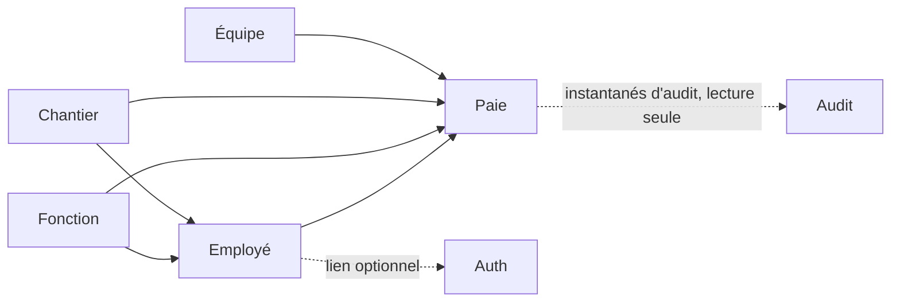

> Vue d'ensemble **concrète** du projet : ce qu'il contient, comment les domaines dépendent les uns des
> autres, et le trajet d'une requête de bout en bout. Les principes généraux (couches, patterns,
> conventions de code) sont dans `conventions/architecture.md` ; ce document décrit leur application ici.

---

## Vue d'ensemble

```text
Navigateur ── Angular (UI Staport) ──HTTP/JSON──▶ API FastAPI (Python 3.14) ──SQLAlchemy async──▶ PostgreSQL 18
                    │                                   │
                    │                                   ├── Alembic (schéma V1…V44 puis révisions, droits du compte applicatif)
                    │                                   ├── Audit : écouteurs de session SQLAlchemy + journal d'audit (qui, quoi, quand, avant / après)
                    │                                   ├── openpyxl (imports/exports Excel)
                    │                                   ├── WeasyPrint (rapport PDF)
                    │                                   ├── Courriel SMTP (mot de passe oublié)
                    │                                   ├── Serveur MCP FastMCP (`/mcp`) pour l'agent IA
                    │                                   └── Appel HTTP à l'ERP Staport (chantiers)
                    └── jeton d'accès en mémoire, jeton de rafraîchissement en cookie httpOnly
```

| Brique | Choix |
|---|---|
| Backend | Python 3.14, FastAPI, Pydantic, SQLAlchemy 2 (asynchrone, pilote psycopg 3), authentification par jetons JWT RS256, FastMCP 4 ; OpenAPI générée par FastAPI |
| Base | PostgreSQL 18.6 avec pgvector ; usage vectoriel uniquement lorsqu'un cas RAG sera validé |
| Migrations | Alembic ; la base canonique V1 → V44 est reprise telle quelle puis étendue par des révisions ; un test vérifie que le schéma correspond exactement aux modèles |
| Frontend | Angular 22.2.2 standalone, Signals, Angular Aria/CDK, Tailwind CSS 4, Lucide et composants Staport |
| Tests | pytest + testcontainers (API), Vitest + Playwright/axe (frontend) — voir [testing.md](../exploitation/tests.md) |
| Livraison | Images Docker publiées par la CI ; nginx « inner » sert le frontend et relaie l'API — voir [deployment.md](../exploitation/deploiement.md) |

**État des environnements au 2026-10-10 :** le Docker local est sur PostgreSQL 18.6 avec les données
migrées depuis PG17 ; le serveur de production reste sur PostgreSQL 17 jusqu'à l'exécution de la
procédure contrôlée décrite dans [deployment.md](../exploitation/deploiement.md). Le Compose de la branche ne doit donc
pas encore être déployé tel quel en production.

---

## Les domaines

Un module backend par domaine métier (`api/src/staport/domains/<domaine>/`) et un dossier
frontend du même nom (`frontend/src/app/portail/<domaine>/`).

| Domaine | Module backend | Table(s) | Dépend de (par façade de service) |
|---|---|---|---|
| Fonction | `function` | `fonction` | — |
| Chantier | `chantier` | `chantier` | — (source externe : ERP) |
| Équipe | `equipe` | `equipe` | — |
| Employé | `employee` | `employe` | Fonction, Chantier |
| Paie | `paie` | `paie` | Employé, Fonction, Chantier, Équipe, Audit (instantanés de restauration, lecture seule) |
| Heures supplémentaires | `heuresupp` | `heures_supp` | Employé, Chantier, Paie |
| Paramètres | `parametre` | `parametre` | — |
| Audit | `audit` | `audit_journal`, `audit_revision`, tables `*_aud` | — |
| Accueil | `accueil` | `accueil_preference` | — |
| MCP | `mcp` | — | Outils de lecture des domaines, droits par outil |
| Auth | `auth` | `utilisateur`, `role`, `permission`, `role_permission`, `utilisateur_role`, `utilisateur_permission_refusee`, `refresh_token`, `reset_password_token` | Employé |
| Commun | `common` | — | Types partagés (pagination, `Montant`), sécurité, contexte d'audit ; la plateforme (`platform/`) porte la configuration, la base, les erreurs et la sonde de santé |



Une flèche signifie « utilise la façade de service de ». **Aucun domaine n'utilise le repository d'un
autre** (`conventions/architecture.md`, « Encapsulation des domaines ») : un domaine qui doit référencer
une entité d'un autre vérifie l'existence par la façade du service, puis référence l'entité par son identifiant sans
la charger.

Pour restaurer un groupe supprimé, Paie demande à l'audit les instantanés d'une entrée de suppression réussie. L'audit ne
dépend pas du service Paie pour cette lecture et ne réalise aucune écriture métier ; la restauration, ses invariants et son
audit restent dans Paie.

Les composants transverses qui produisent des événements d'audit dépendent du port d'écriture du domaine Audit
(`staport.domains.audit.api`). La consultation reste exposée par le service d'audit.

### Structure d'un module

```text
<domaine>/
├── router.py        Routes REST minces (aucune logique), `exiger("PERMISSION")` sur chacune
├── schemas.py       Modèles Pydantic : requêtes (création, modification, critères) et réponses
├── models.py        Modèles SQLAlchemy (persistance, jamais un contrat d'API)
├── exceptions.py    Exceptions métier + gestionnaires d'erreurs du domaine
├── repository.py    Accès aux données (requêtes SQLAlchemy asynchrones)
├── service.py       Règles métier et façade du domaine
├── audit.py         Déclaration des opérations auditées du domaine
└── import_*.py, export.py, report/   (si applicable) imports Excel, export Excel, rapport PDF
```

---

## Trajet d'une requête

1. **Frontend** : l'intercepteur d'authentification ajoute `Authorization: Bearer <jeton d'accès>`. Sur un
   `401`, il tente un unique rafraîchissement (`/auth/refresh`, partagé entre les requêtes concurrentes) puis
   rejoue la requête ; en cas d'échec, il vide la session et renvoie vers `/login`.
2. **nginx inner** (en production) ou **proxy Angular** (en développement) : relaie vers l'API les
   chemins d'API. Les préfixes `/employees`, `/chantiers`, `/functions`, `/equipes`, `/paie` sont à la fois
   des routes Angular et des préfixes d'API : l'en-tête `Accept: text/html` (navigation) sert l'application,
   le reste va à l'API.
3. **Authentification** : l'API valide la signature RS256, l'émetteur, le destinataire et l'expiration du jeton, puis
   relit le compte et ses permissions.
4. **`exiger("X")`** sur la route : refuse en `403` sans la permission.
5. **Validation** des modèles Pydantic : `400` avec la liste `champ : message` ; les montants sont arrondis à deux
   décimales par le type partagé `Montant` avant d'être contrôlés.
6. **Service** : règles métier, vérification des doublons (`409`) et des références (`400`), transaction.
7. **Réponse** : modèle de réponse (jamais une entité). Toute erreur a la forme
   `timestamp`, `status`, `error`, `message`, `path` (`staport/platform/erreurs.py`), affichée par l'intercepteur d'erreurs du
   frontend dans une notification.

### Codes d'erreur courants

| Code | Cause |
|---|---|
| 400 | Validation, référence inconnue (fonction, chantier, équipe, employé), import rejeté |
| 401 | Jeton absent, expiré, invalide ou signé avec une autre clé |
| 403 | Permission manquante (journalisé : événement `ACCES_REFUSE`) |
| 405 | Méthode HTTP non prévue pour la route |
| 404 | Ressource inexistante |
| 409 | Doublon (code, CIN, libellé, bulletin), suppression d'un élément encore référencé (dont un rôle attribué), groupe de bulletins modifié entre-temps |
| 500 | Erreur inattendue (message générique, détail dans les logs) |

---

## Traitements planifiés et externes

| Élément | Détail |
|---|---|
| Synchronisation des chantiers | Tous les jours (23 h UTC par défaut, paramètre `chantier.synchronisation.cron` relu avant chaque exécution) ou à la demande (`POST /chantiers/sync`) — ajoute les chantiers absents, ne modifie rien. Voir [chantier/README.md](../domaines/chantier/index.md) |
| Sauvegarde PostgreSQL | Service Docker dédié : exécution quotidienne à 02:00 UTC, rétention locale de 30 jours dans `./backups/` ; la destination locale seule est acceptée par décision du propriétaire. Restauration d'une archive réelle et alerte à organiser. Voir [deployment.md](../exploitation/deploiement.md) |
| Bootstrap administrateur | Au démarrage, crée le compte `SYSTEM_ADMIN` s'il n'en existe aucun. Voir [auth/README.md](../domaines/auth/index.md) |
| Vérification de l'intégrité de l'audit | Au démarrage, signale si le compte de la base peut modifier une table d'audit ; la chaîne d'intégrité du journal est vérifiée à intervalle régulier (`AUDIT_INTEGRITE_CHAINE_DELAI_MS`). Voir [audit/README.md](../domaines/audit/index.md) |
| Courriel | Envoi du lien « mot de passe oublié » (SMTP) |

---

## Supervision et documentation d'API

| Élément | Accès |
|---|---|
| Documentation OpenAPI | `/openapi.json` et `/docs` (Swagger UI), **éteints par défaut** (donc en production : ces routes n'existent pas, `404`) ; allumés en développement par `API_DOCS_ENABLED` (spécification) et `SWAGGER_UI_ENABLED` (interface, qui exige la spécification) |
| Santé | `/health` (public — utilisé par les healthchecks Docker) : l'application répond et la base répond |
| Mesures Prometheus | `GET /metrics` : audit (`rh_audit_*` : écritures en échec, événements de sécurité, intégrité, chaîne) et synchronisation des chantiers (`rh_chantier_sync_*`). Public comme la santé (aucune donnée sensible) mais **joignable depuis le serveur seulement** : nginx inner ne relaie pas ce chemin, le port de l'API est lié à `127.0.0.1`. Raccordement opérationnel suivi dans Jira (KAN-163) |
| Logs | Module `logging` de Python ; jamais de secret, identifiant de connexion, identité d'employé ni contenu métier/financier (voir `conventions/logging.md`). Format : texte en développement ; **JSON en production** (`LOGGING_FORMAT=json`, une ligne par événement, seule clé de contexte : `requestId`) ; en plus de la console, `LOGGING_FILE_PATH` écrit `application.json`, archivé chaque jour à minuit UTC, compressé et gardé 30 jours dans `./logs/archive`. L'acteur reste traçable dans l'audit à accès contrôlé |
| Traces | Un span de diagnostic par appel d'outil MCP (OpenTelemetry), sans donnée métier |

---

## Frontend

Voir frontend/README.md ([frontend/index](../frontend/index.md)) : structure, routes, guards par permission, composants
partagés (sélecteur à chargement différé, tableaux configurables), conventions d'interface.

---

## Décisions d'architecture notables

| Décision | Raison |
|---|---|
| Schéma géré uniquement par Alembic | Aucune modification de schéma silencieuse ; un test de dérive fait échouer la CI si les modèles et la base divergent |
| Fonction, chantier et équipe copiés sur le bulletin (snapshot) | Un bulletin garde la situation du mois, même si l'employé est réaffecté ensuite |
| JWT auto-émis en RS256 | Un seul jeu de clés signe les jetons des utilisateurs et ceux de l'agent IA (audiences distinctes) ; la clé publique est servie par JWKS pour qu'un autre service puisse les valider |
| Jeton d'accès en mémoire, jeton de rafraîchissement en cookie `httpOnly` | Le jeton d'accès n'est jamais volable par du JavaScript injecté |
| Imports Excel atomiques et en ajout seul | Un fichier invalide ne laisse rien d'à moitié importé ; aucune modification silencieuse par fichier |
| Rapport PDF en HTML + WeasyPrint, graphiques SVG | Pagination entièrement pilotée par le code Python (voir [report/README.md](../domaines/rapport/index.md)) |
| CORS restreint par environnement | `CORS_ALLOWED_ORIGINS` fournit des origines explicites sans wildcard ni chemin (voir [deployment.md](../exploitation/deploiement.md)) |
| Paie non calculée | Le total est repris tel que saisi ou importé (décision du 2026-10-03) |
| Audit : historique des entités + journal unique + événements de sécurité + garde-fous | L'historique des entités seul a des angles morts (écritures en masse, cascades SQL, migrations, événements sans donnée modifiée) ; chacun est fermé et prouvé par un test — voir [audit/README.md](../domaines/audit/index.md) |
| Aspect d'audit à l'intérieur de la transaction (ordre explicite) | L'entrée d'une opération réussie est validée ou annulée avec ses données ; un échec est tracé à part |
| Deux comptes PostgreSQL | Sans séparation, l'application pourrait réécrire l'historique : un `REVOKE` serait cosmétique |

---

## Limites connues

### Intégration IA — cible décidée, non livrée

Le métier reste dans l'API Python ; un service IA Python (LangGraph) consomme le serveur MCP de l'API (FastMCP, route `/mcp`)
et appelle les modèles par LiteLLM ; Angular dialogue avec lui par AG-UI, via le runtime Node CopilotKit. Les API REST et le kit
Staport restent les interfaces des écrans. Les jetons délégués par audience, les périmètres de
données par fiche de poste, la projection du salaire et l'audit de chaque outil sont des prérequis :
les protections des contrôleurs REST ne sont pas héritées par un appel direct aux services. Le RAG
ne recopie ni les employés ni la paie. Le serveur MCP et son interopérabilité (clients TypeScript et Python, jeton agent RS256) sont prouvés par
`api/tests/test_mcp_clients_externes.py`.
Décisions, feuille de route et état : [ia.md](../ia/pratiques-de-reference.md).

### Autres limites

Suivis dans Jira (projet `KAN`) : domaine Pointage non construit (KAN-171), déploiement continu manuel,
qualité des données (champs obligatoires et doublons : KAN-177 et KAN-160).
