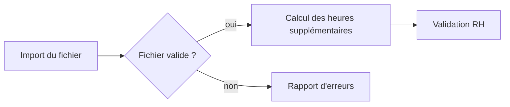

# Essai de rendu des diagrammes

Page d'essai (KAN-188) : elle prouve que Mermaid s'affiche dans le site. Elle sera remplacée par le premier vrai
processus documenté.

## Essai BPMN 2.0

Même processus, au format `.bpmn` (fichier versionné dans `static/bpmn/`), affiché par bpmn-js. Le filigrane bpmn.io en bas à droite est exigé par la licence.

import BpmnViewer from "@site/src/components/BpmnViewer";

<BpmnViewer src="bpmn/essai-import-hs.bpmn" />
